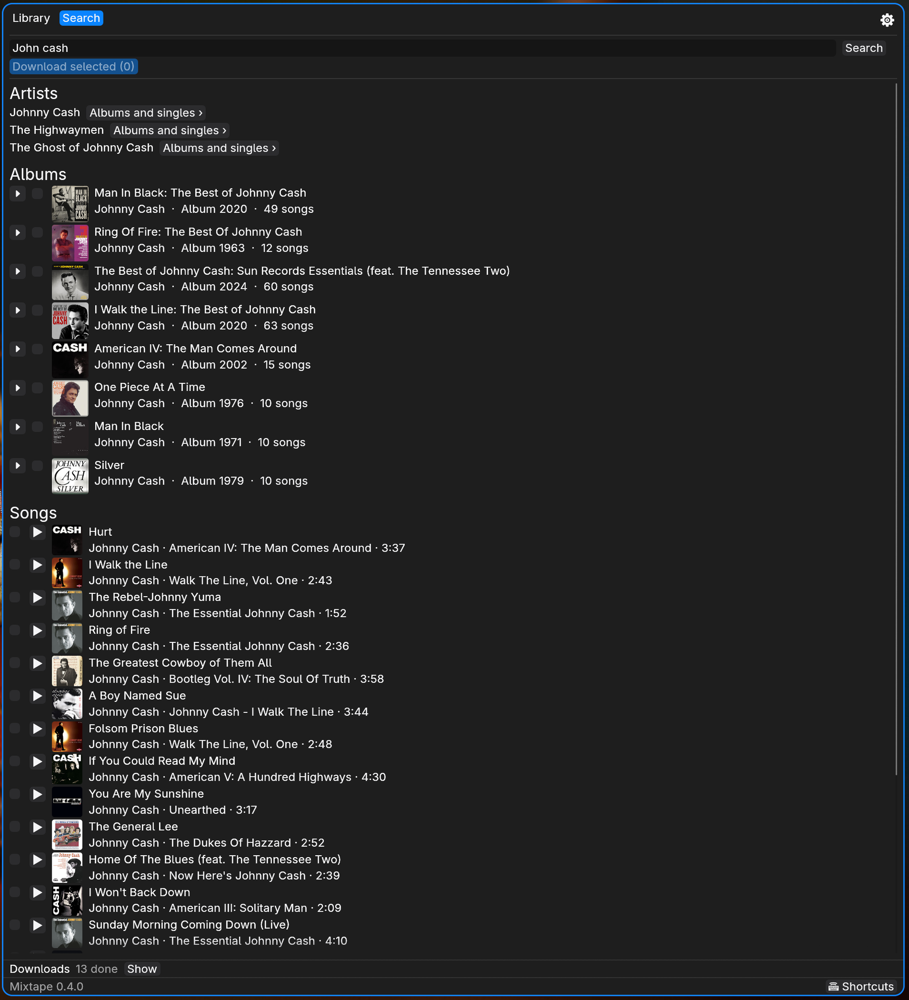

# Mixtape

[](https://github.com/dreed47/mixtape/actions/workflows/ci.yml)

A small desktop app for Linux that searches YouTube Music, downloads songs as
MP3 into an `Artist/Album/` folder structure, and opens folders of your music
in the player you choose. It follows the [Omarchy](https://omarchy.org) theme
when Omarchy is installed and works on any Linux desktop otherwise.



## Features

- **Search** by artist, song, album, or a mix. Partial and misspelled searches
  work, because YouTube Music does the matching.
- **Paste a link** to a YouTube or YouTube Music song, album, playlist, or
  artist instead of searching.
- **Artists** show up in search results. **Albums and singles ›** lists
  everything they've released, with a button to select it all.
- **Albums** show up as their own rows. Open one to see its tracks, or tick it
  to select every track you don't already have.
- **Preview** a result with its ▶ button to hear it without downloading
  (needs mpv).
- **Download several songs at once.** Tick songs, then click
  **Download selected**. Two songs download at a time and the rest wait in a
  queue, each with a progress bar.
- **Already-downloaded check.** Songs you already have are marked
  **In library**. Mixtape knows a song is in your library when it downloaded
  that song before, or when a file in your music folder matches its artist and
  title. Ticking one asks before downloading it again.
- **Library.** Browse your music folder down to each song, filter it by
  artist, album, or song name, or switch to **Recently added**. Tick songs or
  folders, then click **Play selected** to open them in your player, or
  **Move to Trash** to remove them (you can restore them from the Trash).
  Double-click a song to play it. Right-click a song to play it, open it in the
  Stems app when it is installed, or show it in your file manager. Right-click
  a folder, or click **Open in file manager**, to open it there.
- **Duplicates.** The Library lists songs you have more than once (same
  artist and title, same length), so you can trash the extra copies.
- **Downloads resume.** Songs still waiting when you close Mixtape start
  again the next time you open it.
- **Settings.** Choose the music folder (local or a network share), the
  player (Amberol, VLC, mpv, or any command), the file format, and whether to
  use a YouTube Music Premium login.

## Audio quality

Mixtape always downloads the best audio YouTube Music offers your account.
Without Premium that's Opus at about 130 kbps. With Premium it's AAC at
256 kbps.

| Format setting | What you get |
| --- | --- |
| **MP3** (default) | Converted to MP3 at the highest VBR setting (V0). Plays on everything, but converting a lossy file can't add quality. |
| **Original** | The audio exactly as YouTube sends it, with no conversion: `.opus`, or `.m4a` with Premium. Best quality at about half the size. Some car stereos and older devices can't play Opus. |

Songs are saved as `<music folder>/<Artist>/<Album>/<Title>.<ext>`. Songs
downloaded from an album's track list start with their track number
(`01 Title.mp3`) so players keep album order. Title, artist, album, and track
number tags come from YouTube Music, and the cover art is cropped square. MP3 files get the cover art embedded. In
Original format the cover is saved as `cover.jpg` in the album folder, which
music players pick up.

### YouTube Music Premium

In **Settings**, turn on **Use my YouTube Music Premium login** and choose the
browser where you're signed in to music.youtube.com. yt-dlp then reads that
browser's YouTube login on your computer (`--cookies-from-browser`). Mixtape
never stores or sends the login itself. Without a Premium account the setting
changes nothing.

## Requirements

- Linux with a Wayland or X11 desktop
- [Rust](https://www.rust-lang.org/tools/install) (to build)
- [uv](https://docs.astral.sh/uv/) (runs the YouTube Music search through
  [ytmusicapi](https://github.com/sigma67/ytmusicapi); uv fetches it on first
  search)
- [yt-dlp](https://github.com/yt-dlp/yt-dlp) and [FFmpeg](https://ffmpeg.org)
- A music player, for example Amberol, VLC, or mpv

If something is missing, Mixtape says what and shows the command that
installs it. **Settings** lists every program it uses.

On Arch Linux and Omarchy:

```bash
sudo pacman -S rust uv yt-dlp ffmpeg
```

## Install

```bash
git clone https://github.com/dreed47/mixtape.git
cd mixtape
bin/install.sh
```

This builds Mixtape, installs the `mixtape` binary to `~/.local/bin`, and adds
Mixtape to your app launcher. Make sure `~/.local/bin` is on your `PATH`.

## Update

Mixtape checks GitHub for a newer release when it starts and once a day after
that. When one is out, the footer shows it with an **Update** button. Click it
to install the release, then click **Restart to finish**. You can turn the
check off in **Settings**.

To update from a terminal instead, run this from the folder you cloned:

```bash
bin/update.sh
```

Both install the newest tagged release, not unreleased work on `main`.

## Uninstall

```bash
bin/uninstall.sh
```

This removes the app and its launcher entry. Your music, settings, and
download log stay where they are.

## Files Mixtape uses

| Path | What's in it |
| --- | --- |
| `~/.config/mixtape/settings.json` | Music folder and player |
| `~/.local/share/mixtape/downloads.tsv` | Log of songs Mixtape downloaded |
| `~/.local/share/mixtape/queue.json` | Songs waiting to download |
| `~/.cache/mixtape/songs.json` | Song details and tags, so scans are fast |
| `~/.local/share/mixtape/source-dir` | The folder Mixtape was installed from, for **Update** |

Mixtape respects `XDG_CONFIG_HOME` and `XDG_DATA_HOME`.

## Development

```bash
cargo run          # run from source
cargo test         # unit tests
cargo fmt          # format (CI checks it)
cargo clippy --all-targets -- -D warnings   # lints (CI checks it)
```

In a development copy, create an empty `.mixtape-dev` file in the repository
folder (`touch .mixtape-dev`). The footer still says when a release is out,
but the **Update** button leaves the copy alone, so you update it with git.

The code is in `src/`:

- `main.rs`: the window and its three tabs
- `backend.rs`: settings, search, downloads, the download log, and library
  scanning
- `theme.rs`: follows the Omarchy theme
- `ytmusic.py`: the search helper that calls ytmusicapi

## Legal

Download only music you have the right to download. Respect the terms of
service of YouTube Music and the copyright of the artists.

## Versions

See [CHANGELOG.md](CHANGELOG.md). The installed version shows at the bottom
of the window.

## License

[MIT](LICENSE)
